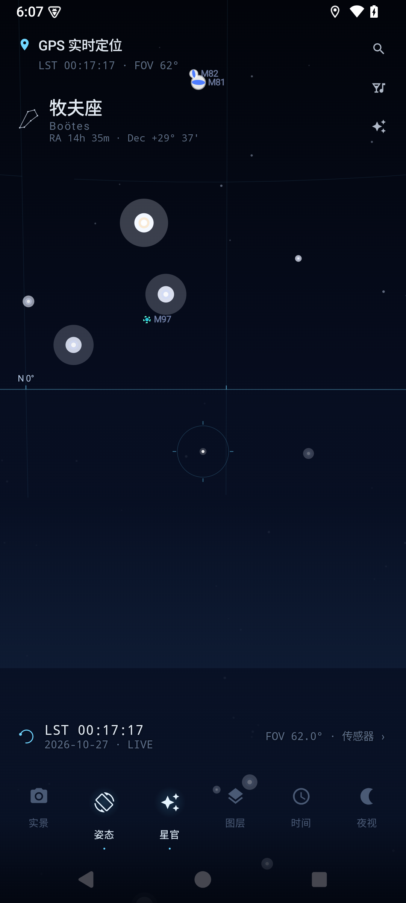
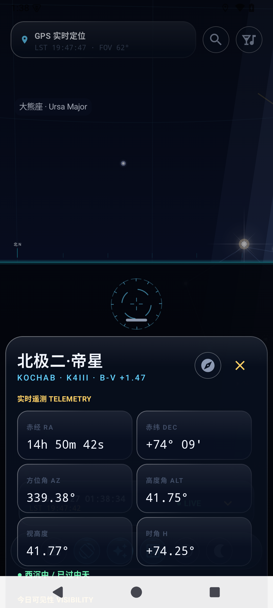
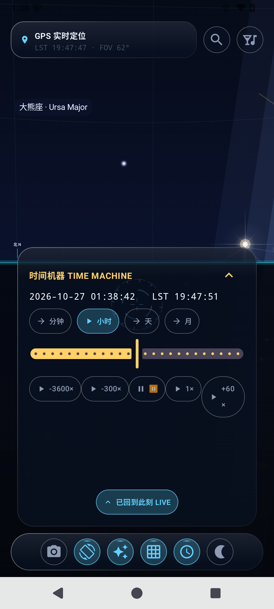
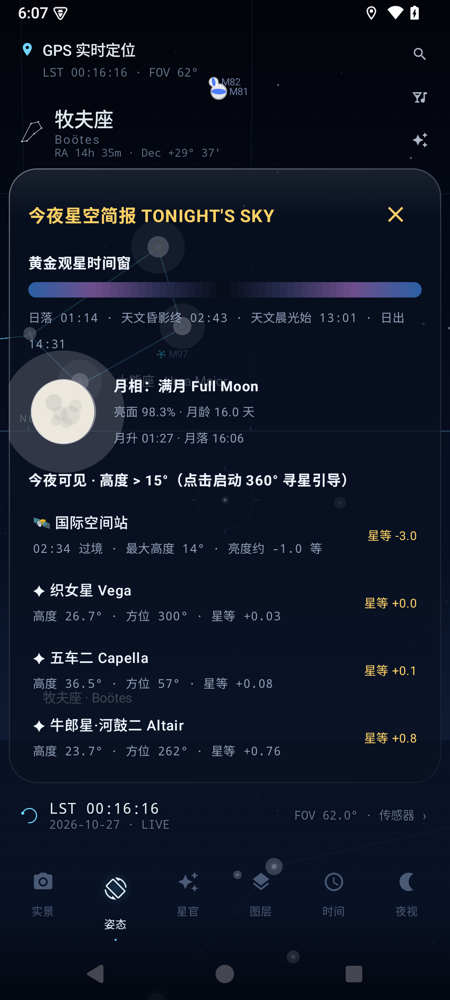
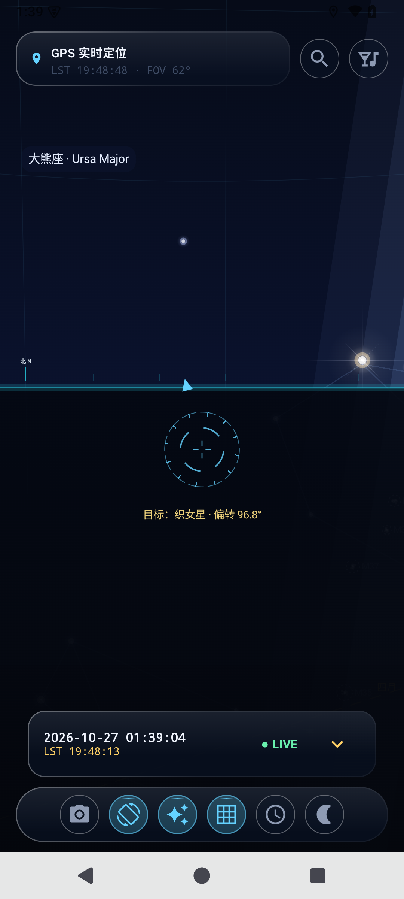
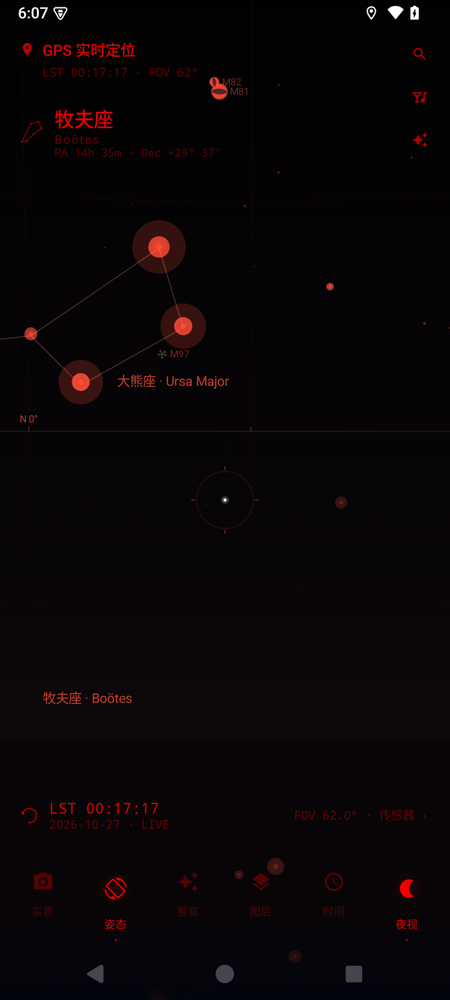
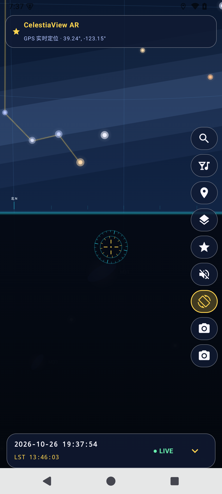
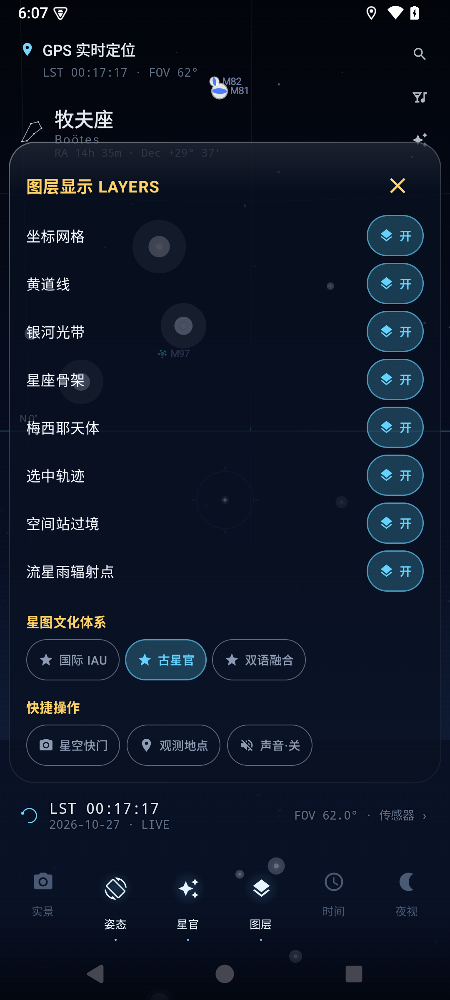

# Aetheris · 无界苍穹 (CelestiaView AR)

> Android AR 实时星空应用 —— 精密天体物理计算 · 传感器四元数融合 · 程序化天体光学渲染 · 磨砂玻璃交互 · 东方古星官体系

星图引擎完全离线运行：亮星星表、星座拓扑、梅西耶天体、流星雨与空间站轨道全部内置；聚焦天体特写时联网拉取 NASA / 哈勃精选与 CDS Aladin DSS2 巡天实拍（核心天体已内置，离线时由程序化高清底片无缝呈现）。

## 界面一览

| 主星图 | 天体百科 | 时间机器 |
|:---:|:---:|:---:|
|  |  |  |

| 今夜简报 | 寻星引导 | 红光模式 |
|:---:|:---:|:---:|
|  |  |  |

| 古星官（三垣二十八宿） | 图层面板 |
|:---:|:---:|
|  |  |

## 快速上手

### 构建与安装

环境：JDK 17 + Android SDK（API 35）。

```bash
./gradlew assembleDebug
adb install app/build/outputs/apk/debug/app-debug.apk
```

release 构建启用 R8 代码压缩与资源收缩，签名凭据读取自根目录 `keystore.properties`（`storeFile` / `storePassword` / `keyAlias` / `keyPassword`）；该文件与密钥库保留在本机，缺席时 release 构建回退 debug 签名。

```bash
./gradlew assembleRelease
```

首次启动请求定位权限（可选），AR 实景模式另行请求相机权限。聚焦特写的内置实拍贴图可用 `python scripts/prefetch_astrophotos.py` 重新拉取。

应用以全面屏沉浸模式运行：星空铺满打孔/刘海与手势条区域，交互层自动避让系统栏与凹口，兼容手势导航与三键导航。

### 使用指南

| 操作 | 入口 | 效果 |
|---|---|---|
| 巡天 | 虚拟模式下单指拖拽 + 甩动 | 视线平移，Fling 惯性衰减；左右屏幕边缘 16dp 让位于系统返回手势 |
| 缩放视场 | 双指捏合 | FOV 3°（深空望远镜）~ 110°（超广角）阻尼缩放 |
| AR 实景 | 底部「实景」 | CameraX 实景 + 可调暗化滤镜，星空叠加于真实夜空 |
| 传感器姿态 | 底部「姿态」 | 旋转手机即所见即所得，真北磁偏角自动校准 |
| 观星地 | 左上角观测地名 | GPS / 手动坐标 / 六大暗夜保护区一键穿越 |
| 罗盘微调 | 地点面板 Trim 滑块 | -30°~+30°（0.5° 步进）方位角手动微调 + 对准日月一键校准 |
| 天体识别 | 准星对准天体 | 3.5° 内自动吸附：四角括号收缩 + HUD 抬头标签 + 触觉/音效 |
| 天体百科 | 点击底部吸附信息行 | 220dp 实拍画册横幅 / 24h 高度角曲线 / 遥测行 / 升降时刻 / 物理属性 / 光谱色阶 / 中西典故 |
| 天体特写 | 点击吸附信息行 / 右下「聚焦」 | 视场阻尼锁定 + 顶部锁定态芯片；45°→18° S 曲线浮现天球视差对齐的真实摄影贴图（角直径随视场物理缩放，滤色融进星砂）与等宽遥测铭牌 |
| 寻星引导 | 右上检索图标或今夜榜单点击目标 | 360° 离轴箭头 + 偏转角倒计时 + 入镜锁定脉冲，到位即自动平滑变焦至天体特写 |
| 时间机器 | 左下角时间印记或底部「时间」 | 无框光学刻度尺（中心发光指针 + 逐格触觉）+ ±3600× 流速 + LIVE 复位 |
| 今夜简报 | 右上月相图标 | 晨昏蒙影时间轴 / 高清月相盘 / 带实拍缩略图的可见天体榜单 + 空间站过境预报 |
| 文化星图 | 底部「星官」循环或图层面板 | 现代国际 IAU / 中国古星官（三垣二十八宿·四象配色）/ 双语融合 |
| 图层开关 | 底部「图层」 | 网格 / 黄道 / 银河 / 星座 / 梅西耶 / 轨迹 / 空间站 / 流星雨 |
| 护眼红光 | 底部「夜视」 | 全屏红光谱滤镜，保护暗适应 |
| 空灵音频 | 图层面板「声音」 | C 大调九和弦深空 Drone + 锁定水晶泛音 |
| 星空海报 | 图层面板「星空快门」 | 当前星图 + 观测铭牌合成 PNG 存入相册 |
| 桌面小组件 | 系统桌面添加「今夜苍穹」 | 实时月相盘 / 月龄 / LST / 今夜推荐，点击直达 AR 寻星 |
| 返回 | 系统返回键 / 侧滑 | 二级面板逐级收起 → 退出锁定与引导，主星图状态退出应用 |

### 深度链接（小组件 / 自动化）

```bash
adb shell am start -n com.celestiaview.ar/.MainActivity \
  --es navigate detail --es target Kochab
adb shell am start -n com.celestiaview.ar/.MainActivity \
  --es navigate focus --es target M31 --ef fov 12
```

`navigate` 取值：`detail` / `focus`（可附 `--ef fov` 望远视场）/ `guide` / `tonight` / `search` / `time` / `layers` / `location` / `redlight` / `culture` / `culture_dual` / `reset`；`target` 支持恒星英文名 / 梅西耶编号 / `MOON` / `SUN` / 行星键。

## 工程架构

```
com.celestiaview.ar
├── core/                          # 纯计算核心层（零 Android UI 依赖，可 JVM 单测）
│   ├── math/
│   │   ├── Vec3.kt                # 双精度向量：点积/叉积/归一化/球面插值 Slerp
│   │   ├── Mat3.kt                # 3×3 旋转矩阵：乘法/转置/Gram-Schmidt 正交化
│   │   ├── Quaternion.kt          # 四元数：矩阵互转/半球对齐/NLERP/SLERP
│   │   ├── AstrometryEngine.kt    # 儒略日/GMST-LST/赤道↔地平/Bennett 折射/升降中天/银道变换
│   │   ├── PlanetaryEphemeris.kt  # JPL J2000 轨道根数+开普勒牛顿迭代；月球解析理论+月相
│   │   ├── CelestialProjector.kt  # 针孔相机投影/背面剔除(z>0.05)/大圆弧 3° 细分
│   │   └── SatelliteTracker.kt    # ISS/天宫圆轨道+J2 升交点进动/地影圆柱模型/过境预报
│   ├── sensor/
│   │   ├── AttitudeTracker.kt     # 旋转矢量→屏幕重映射→磁偏角+方位角微调→自适应 SLERP(视场耦合 0.02~0.35 长焦超稳态) + 1Hz 遥测
│   │   ├── OrbitTouchController.kt# 惯性轨道/指数衰减 Fling/FOV 阻尼/聚焦滑航（帧率无关指数因子）
│   │   └── LocationProvider.kt    # GPS 监听 + 六大暗夜保护区 + GeomagneticField 偏角
│   └── media/
│       ├── ProceduralSoundEngine.kt # AudioTrack 实时合成 Cmaj9 Drone + 泛音锁定音(ADSR)
│       ├── HapticFeedbackManager.kt # 掠星轻颤/锁定重击/滚轮刻度/快门长震
│       └── SkySnapshotExporter.kt   # 星图+铭牌海报 → MediaStore
├── data/                          # 高保真内置数据集（纯 Kotlin，可单测）
│   ├── model/CelestialModels.kt   # Star/Planet/DeepSkyObject/Constellation/TonightEvent(含 SATELLITE/METEOR_SHOWER)
│   └── catalog/
│       ├── BrightStarCatalog.kt    # 230+ 颗真实亮星(HIP/J2000/星等/B-V/光谱/中英名/科普)
│       ├── ConstellationCatalog.kt# 48 星座连线拓扑 + 希腊神话 + 三垣二十八宿典故
│       ├── ChineseSkyCatalog.kt   # 三垣二十八宿完整拓扑：四象配色/32 颗补宿星/篆刻徽章数据/CultureMode
│       ├── MeteorShowerCatalog.kt # 八大流星雨：辐射点/活跃期/极大/ZHR/母体/强度权重
│       ├── MessierCatalog.kt      # 35 个梅西耶天体(坐标/星等/视直径/类型/简介)
│       └── MilkyWayBandData.kt    # 银道光带中线+银心星尘粒子云
└── ui/                            # 表现层（Compose + Canvas）
    ├── theme/DeepSpaceTheme.kt    # 深空色彩体系 + 红光模式状态
    ├── render/
    │   ├── SkyCanvasRenderer.kt   # 12 层渲染管线：星砂场/银河/星官/球面地平弧/聚焦实拍特写（渲染循环零分配）
    │   ├── StarOpticsShader.kt    # B-V→黑体色 / PSF 多层光晕 / 十字衍射星芒 / 八芒耀星 / 大气闪烁
    │   ├── PlateAlignment.kt      # 贴图天球北极视差旋转角 / S 曲线溶解 / 角直径物理缩放（纯函数）
    │   ├── AstrophotoRepository.kt# CDS Aladin hips2fits + NASA/Wikimedia 精选，内存/磁盘/内置三级缓存 + 无痕脱底羽化（四角底色采样+黑位38+82%内切圆+余弦窗+预乘Alpha）
    │   ├── Planet3DRenderer.kt# 行星/月/日实时 3D 球面光线投射着色（等距柱状纹理+兰伯特+菲涅尔+自转）与土星 3D 光环
    │   ├── ConstellationArtRenderer.kt# 黄道十二宫+北天名宿 22 组古典神话白描线稿（成员恒星包围盒天球锚定）
    ├── core/math/SpringAnimator.kt# 二阶临界阻尼胡克弹簧相机（ω₀=8.5, ζ=1.0，子步积分帧率无关）
    │   ├── AstrophotoPlateGenerator.kt # 程序化高清底片（星系旋臂/月面环形山等 11 风格，离线兜底）
    │   └── MoonPhaseRenderer.kt   # 月相半圆+椭圆复合路径(盈亏分档 sweep)/地球照/月海
    ├── components/                # 无界 HUD 与面板组件
    │   ├── TargetReticleOverlay.kt# 微光同心环准星/吸附括号/360° 引导箭头(屏幕边缘判定)/N-E-S-W 罗盘标/锁定脉冲
    │   ├── TimeMachineScrubber.kt # 无框光学刻度尺（中心发光指针）+ 多倍速播放栏（入口为左下时间印记）
    │   ├── CelestialDetailSheet.kt# 画册级实拍横幅 + 24h 高度角曲线 + 百科四模块 + 离散光谱色阶条
    │   ├── TonightSkyGuideSheet.kt# 今夜简报：蒙影时间轴/月相盘/带实拍缩略图榜单 + 空间站过境
    │   └── SearchAndFilterModal.kt# 四分类检索 + 一键导航
    ├── SkyViewModel.kt            # 状态中枢：帧循环/时间机器/吸附/文化体系/空间站/流星雨
    ├── MainActivity.kt            # CameraX + 无界 HUD 总装 + 深度链接导航 + 手势
    └── widget/TonightSkyWidgetProvider.kt # 今夜苍穹桌面小组件(月相 Bitmap/LST/推荐)
```

### 12 层光学渲染管线

| 层 | 内容 |
|---|---|
| L1 | 大气散射天穹：黑夜 / 晨昏蒙影（太阳方位橙紫瑞利光晕）/ 暗化白昼三态 |
| L2 | 银河银道面流光带：三层柔光描边（星尘蓝 / 淡紫蓝 / 暖星光）+ 银心径向增强 + 星尘粒子 |
| L2.2 | 背景星砂场：固定种子 4000 颗天文幂律微星——85% 为 0.5~0.9dp 星尘，15% 带黑体色温亮星；8 阶高斯光晕预烘焙位图精灵（软 GPU 铁律：多阶渐变着色器会击穿模拟器渲染进程） |
| L2.5 | 流星雨火流星粒子层：对象池零分配 / 辐射点向外辐射 / 电离余迹渐隐 |
| L3 | 地平经纬网 15° / 天赤道 / 金色虚线黄道 + 十二月刻度 |
| L3.5 | 三垣二十八宿文化层：四象配色宿线 + 篆刻菱形宿名徽章 + 金色垣墙（地下剔除） |
| L4 | 梅西耶程序化渲染：星系双色渐变椭圆 / 星云洋红-青双辉 / 星团粒子簇 + 虚线环 |
| L5 | 星座骨架：0.6dp 极细线常驻 25% 透明度，准星 25° 内点亮；双语铭牌为微阴影纯文本（古星官模式下让位） |
| L6 | 恒星 PSF：B-V 黑体色 / 3.5r 大气光晕 / m≤1.5 十字星芒 / 地平高度闪烁调制 |
| L7 | 太阳 / 月球 / 八大行星实时 3D 球面渲染：逐像素光线投射 + 等距柱状纹理双线性采样 + 兰伯特晨昏线 + 边缘昏暗 + 菲涅尔大气微光 + 实时自转，土星附卡西尼缝光环（离屏 128/256 位图缓存保软 GPU 60fps） |
| L7.5 | 空间站金色太阳能翼矢量图标 + 前后 15 分钟过境弧（30s 桶缓存）+ 地影/日照状态 |
| L7.8 | 聚焦实拍特写（深空）：天球北极视差角旋转对齐 + 角直径随视场物理缩放，45°→18° S 曲线淡入；四角底色采样 + 黑位 38 + 82% 内切圆无痕脱底，滤色融进星砂；行星 / 月 / 太阳聚焦由 L7 3D 球面接管（双星同框对比 + RA/DEC 旁注） |
| L8 | 选中天体 24h 运行弧线：16dp 冰蓝轨道光带 + 每 14dp 圆点珍珠，聚焦进度驱动自中心向两端流光展开 |
| L9 | 球面地平弧（0.8dp 微光）+ 15° 刻度针 + 45° 方位角文字 + 地下暮光渐变（地下天体 22% 透视） |

## 数学内核

- **时间系统**：`JD = t/86400000 + 2440587.5`；GMST IAU1982 级数；J2000 校准误差 < 1e-6 天
- **坐标变换**：赤道→地平采用 ENU 分量法（`E = -cosδ·sinH`），方位角 `atan2(E, N)` 无象限歧义
- **大气折射**：Bennett(1982) `R = 1.02/tan(h + 10.3/(h+5.11))′`
- **行星星历**：JPL Keplerian 根数 + 每世纪变率；开普勒方程 5 次牛顿迭代；以 2000 年春分（黄经 0°）/ 夏至（90°）为锚点，误差 < 1°
- **月球**：五基本辐角 + 10 项黄经摄动；以 2000-01-21 月全食（满月）、2000-02-05 日食（新月）为锚点
- **空间站**：圆轨道 + J2 升交点进动（ISS -5.00°/天，天宫 -4.13°/天，历元 2026-10-27）；圆柱地影模型；30s 步进过境搜索；ECI→ENU 视角速度解析
- **姿态融合**：旋转矢量→行主序矩阵（`v_world = R·v_device`）→屏幕重映射→`Rz(-decl + trim)` 真北对齐→半球对齐 + 自适应 SLERP，端到端姿态链精度约 0.07°
- **投影**：右手相机基 (right, up, backward)，`zc = -z_cam` 前向深度；地平圈按球面弧采样绘制，地下天体以 22% 透明度透视呈现

## 测试

解算层锚定外部天文事实（J2000 儒略日、春分/夏至太阳黄经、日月食月相、行星半长轴、银心坐标），数据目录校验典章结构与引用完整性；instrumented 侧覆盖深度链接导航、时间机器状态机与小组件月相渲染。

| 套件 | 覆盖 |
|---|---|
| MathPrimitivesTest | 向量/矩阵/四元数运算、旋转往返、SLERP 中点、半球对齐 |
| AstrometryEngineTest | J2000 儒略日、GMST、北极星高度、Bennett 折射、升落中天时序、昼夜弧长 |
| PlanetaryEphemerisTest | 行星坐标域、半长轴回验、春分/夏至锚点、日月食月相锚点、星等范围 |
| CelestialProjectorTest | 视轴中心投影、背面剔除、焦距像素映射、四元数↔轨道一致性、大圆连续性 |
| CatalogIntegrityTest | 星表 ID 唯一性与坐标域、连线引用完整性、黄道十二宫、梅西耶引用、银心坐标 |
| SatelliteTrackerTest | 星下点倾角带、轨道周期回归、24h 可见性、过境时序一致性、地影圆柱模型 |
| ChineseSkyAndMeteorCatalogTest | 二十八宿完整序/四象各七宿/三垣拓扑/跨年活跃期/极大强度权重/CultureMode |
| ExtremeEpochTest | 公元 1000 / 3000 年极端纪元：儒略日锚点、开普勒收敛、月球级数与过境搜索稳定性 |
| HudInstrumentedTest | 深度链接导航、时间机器状态机、传感器切换、帧循环活性、今夜榜单 |
| WidgetInstrumentedTest | 满月/新月位图像素级验证 + 小组件布局构建 |

## 数据来源与致谢

- 数据源：Hipparcos / Yale BSC（恒星）、JPL planetary fact sheet（轨道根数）、Messier catalog、IMO Meteor Shower Calendar（流星雨）、CelesTrak 近似根数（空间站）
- 空间站追踪采用近似圆轨道 + J2 进动模型，数天尺度内与真实 TLE 保持方位一致
- 应用完全离线运行，所有天文数据内置，运行时无第三方数据依赖
